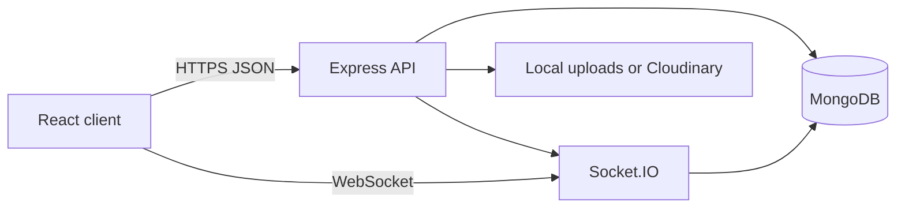

# System architecture

The React app renders pages and calls `/api`. Vite proxies that prefix to Express in development. Express validates input with Zod, loads the user from the JWT, and calls a service. Services write Mongoose documents and, when something another person should see has happened, save a notification and emit it on that user's socket room.

Auction rooms are public to subscribers because bid prices are public. Conversation rooms are joined only after the server checks membership.

The process entrypoint is `backend/src/server.js`. Tests import `backend/src/app.js` and never start the socket server or the interval. They call `refreshAuctionStates` themselves.
