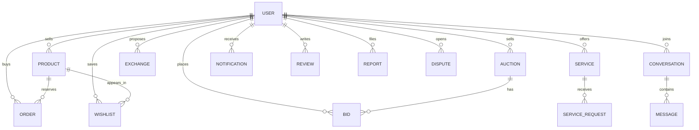

# Database design

Relationships use ObjectId references. Recently viewed products and watched auctions are embedded on the user because they are per-person lists, not shared records. Wishlist is its own collection with a unique pair of user and product.

Indexes cover email, product status plus category and price, auction status plus end time, bids by auction, orders by product and status, one open review per reviewer and transaction, and conversation participants.

Enums constrain category, condition, year, and every status field. `createdAt` and `updatedAt` are on every collection.
