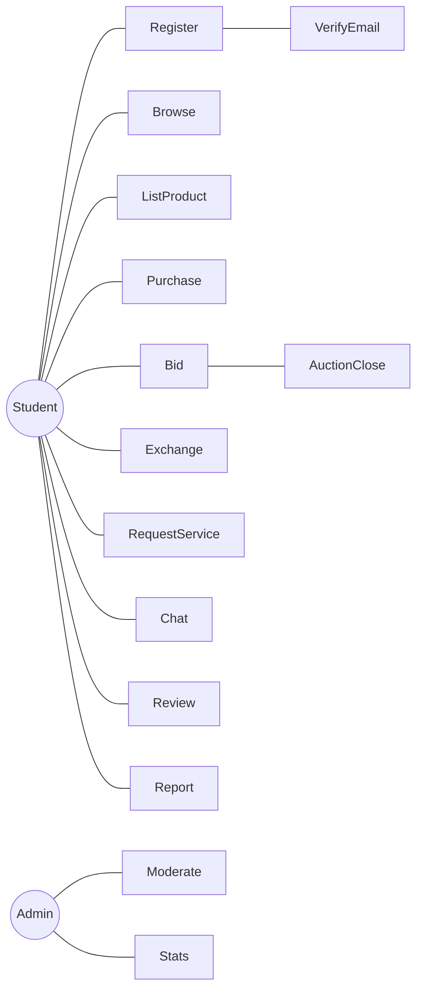

# Use case diagram

Students reach listing, bidding, purchase, exchange, and service requests only after verification. Admins reach moderation and statistics. Auction closing is a system behavior that follows bidding, not a button on the page.
